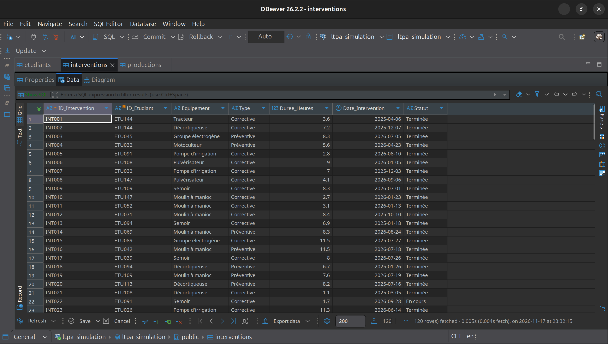

# 📓 Journal de Bord - Projet Data LTPA

## Session 1 : Initialisation et Architecture des Données

### 1. Contexte
Création d'une simulation de pipeline ETL pour le site du LTPA de Yabassi. Les données simuleront la gestion des étudiants et des productions agricoles.

### 2. Actions réalisées
*   Vérification de l'environnement (Linux, Docker, Python).
*   Création de l'environnement virtuel Python (`venv`).
*   Installation des dépendances : `pandas`, `sqlalchemy`, `psycopg2-binary`, `faker`.
*   Initialisation des fichiers de documentation (`README.md` et `JOURNAL_DE_BORD.md`).
*   Création des fichiers `.gitignore` et `requirements.txt`.

### 3. Configuration de la Base de Données (Docker)
*   Création d'un fichier `docker-compose.yml` (PostgreSQL 17).
*   Exposition sur le port `5434` pour éviter les conflits avec d'autres projets locaux.
*   Utilisation d'un volume nommé (`postgres_data`) pour la persistance des données.

### 4. Conception des données (Basée sur le dossier de contenu LTPA)
*   **Départements :** PA, PV, TCPA, MEA.
*   **Options (11) :** Aquaculture, Monogastriques, Bovins, Cultures Pérennes, Semences, Céréales, Maraîchage, Racines, Transformation Animale, Transformation Végétale, Maintenance.
*   **Données générées :** 150 étudiants fictifs et 300 productions.
*   **Logique métier :** Respect des dates d'inscription, gestion des unités réalistes (Têtes, Litres, Kg).

### 5. Développement du Pipeline ETL
*   **Script `generate_data.py` :** Utilisation de Faker et random avec seed (42) pour la reproductibilité. Génération des fichiers `etudiants.csv` et `productions.csv` (encodage `utf-8-sig` pour Excel).
*   **Script `main.py` :** Connexion à PostgreSQL via SQLAlchemy. Lecture des CSV (Pandas), suppression des doublons, et chargement dans les tables `etudiants` et `productions` (avec `if_exists="replace"`).

### 6. Problèmes rencontrés & Solutions
*   **Problème :** Erreur `No module named 'psycopg'` lors de la connexion.
*   **Solution :** SQLAlchemy 2.1 utilise par défaut `psycopg` (v3). Modification de la chaîne de connexion en `postgresql+psycopg2://` pour forcer l'utilisation du pilote installé.

### 7. Vérification
*   Connexion réussie via DBeaver sur la base `ltpa_simulation`.
*   Vérification visuelle des 150 étudiants et 300 productions insérés avec succès.

## Session 2 : Audit de la Qualité des Données (Data Quality)

### 1. Problèmes identifiés sur la première version
*   Incohérence temporelle : des productions étaient datées avant l'inscription des étudiants.
*   Incohérence logique : des étudiants récemment inscrits avaient le statut "Diplômé".
*   Incohérence de mesure : les animaux (lapins, moutons) étaient en décimales au lieu d'être en entiers (têtes).
*   Reproductibilité : l'utilisation de dates dynamiques (today) rendait les données différentes à chaque exécution.

## Session 3 : Refonte du Générateur et Modélisation DDL

### 1. Améliorations apportées (Générateur)
*   Refonte du script `generate_data.py` avec des dates fixes pour une reproductibilité totale.
*   Ajout de "fenêtres d'activité" : un étudiant ne peut produire qu'entre son inscription et sa sortie.
*   Gestion des unités : "Têtes" pour les animaux, "Kg" pour les récoltes.
*   Ajout de contrôles d'intégrité (assertions) avant l'export CSV.
*   Création d'une nouvelle table `interventions.csv` pour les activités de maintenance.

### 2. Améliorations apportées (Pipeline ETL)
*   Remplacement de `to_sql(if_exists='replace')` par l'exécution de requêtes **DDL** (Data Definition Language).
*   Création explicite des tables avec les bons types (`DATE`, `NUMERIC`) et les contraintes (`PRIMARY KEY`, `FOREIGN KEY`).
*   Utilisation d'une transaction (`engine.begin()`) : si une erreur survient, aucune donnée n'est insérée (principe du "tout ou rien").

### 3. Vérification visuelle et Preuves
*   Validation dans DBeaver : les colonnes de dates sont bien typées (icône calendrier) et les relations sont établies.
*   Captures d'écran ajoutées au dossier `images/` :

**Table etudiants :**

**Table productions :**

**Table interventions :**
