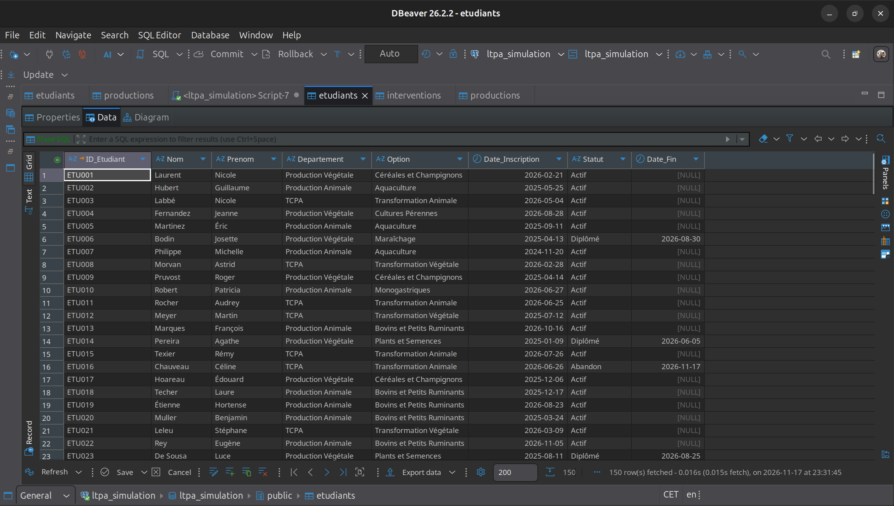
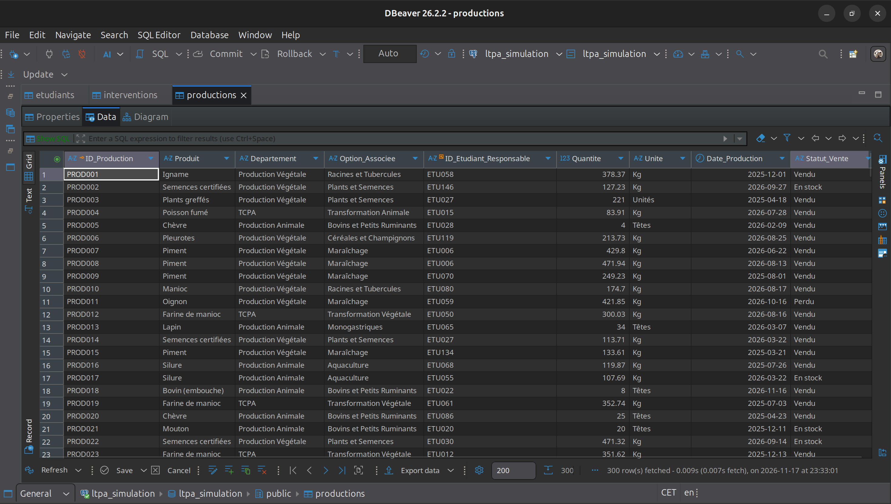
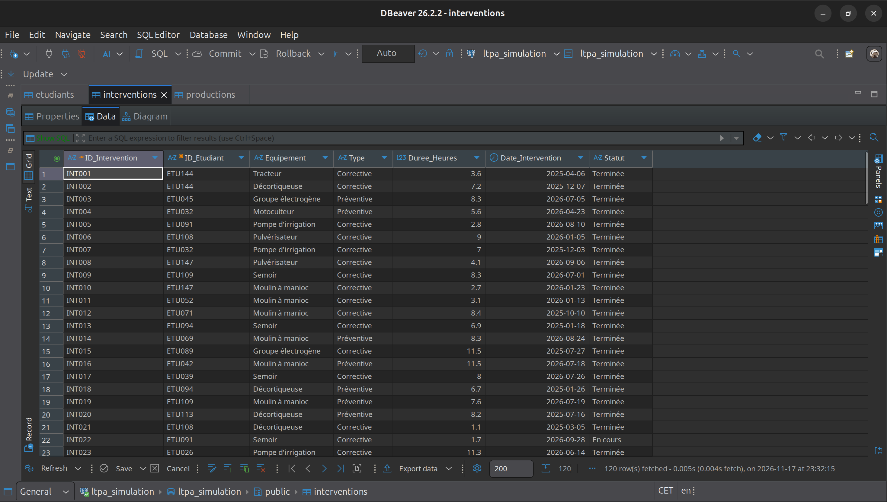
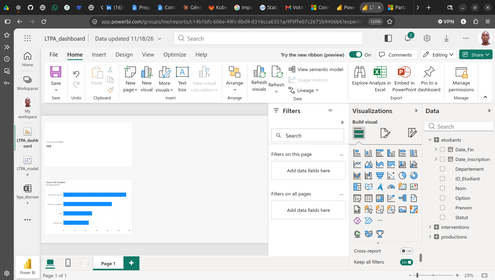

# 🌿 LTPA de Yabassi - Data Pipeline (Simulation)

## 📖 Présentation du projet
Ce projet est une simulation d'ingénierie de données (Data Engineering) basée sur le cas réel du Lycée Technique et Professionnel Agricole (LTPA) de Yabassi (Cameroun). 
L'objectif est de concevoir un pipeline ETL complet pour traiter les données d'inscriptions des étudiants, les données de production agricole (récoltes, élevages, transformations) et les interventions de maintenance.

## 🛠️ Stack Technique
*   **Langage :** Python 3
*   **Manipulation de données :** Pandas
*   **Base de données :** PostgreSQL 17 (via Docker) - *Modélisation relationnelle avec contraintes (DDL, Clés primaires/étrangères)*
*   **ORM/Connecteur :** SQLAlchemy, psycopg2
*   **Génération de données :** Faker (données synthétiques avec contraintes métier)

## 📂 Structure du projet
*   `generate_data.py` : Script de génération de données synthétiques cohérentes (étudiants, productions, interventions). Utilise des règles métier strictes (dates d'activité, unités réalistes) et des assertions de vérification.
*   `main.py` : Script principal du pipeline ETL (Extraction, Transformation, Chargement). Crée les tables via DDL (Data Definition Language) avec les bons types et gère les transactions.
*   `docker-compose.yml` : Configuration du conteneur PostgreSQL.
*   `JOURNAL_DE_BORD.md` : Documentation technique des étapes, des problèmes rencontrés et des solutions apportées.

## 🚀 Comment lancer le projet
1. Cloner le dépôt.
2. Lancer la base de données : `docker compose up -d`
3. Créer l'environnement virtuel : `python3 -m venv .venv`
4. Activer l'environnement : `source .venv/bin/activate`
5. Installer les dépendances : `pip install -r requirements.txt`
6. Générer les données : `python3 generate_data.py`
7. Lancer le pipeline ETL : `python3 main.py`

## 📸 Aperçus de la base de données (DBeaver)
*Preuves visuelles du bon fonctionnement du pipeline et du typage des données.*

**Table `etudiants` :**

**Table `productions` :**

**Table `interventions` :**

**Dashboard Final Power BI :**

