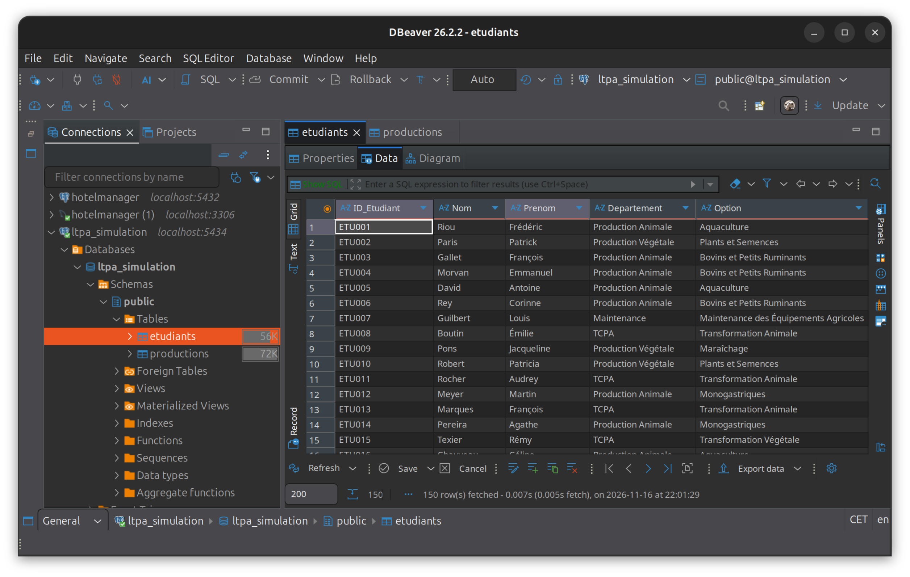

# 🌿 LTPA de Yabassi - Data Pipeline (Simulation)

## 📖 Présentation du projet
Ce projet est une simulation d'ingénierie de données (Data Engineering) basée sur le cas réel du Lycée Technique et Professionnel Agricole (LTPA) de Yabassi (Cameroun). 
L'objectif est de concevoir un pipeline ETL complet pour traiter les données d'inscriptions des étudiants et les données de production agricole (récoltes, élevages, transformations).

## 🛠️ Stack Technique
*   **Langage :** Python 3
*   **Manipulation de données :** Pandas
*   **Base de données :** PostgreSQL 17 (via Docker)
*   **ORM/Connecteur :** SQLAlchemy, psycopg2
*   **Génération de données :** Faker

## 📂 Structure du projet
*   `generate_data.py` : Script de génération de données synthétiques réalistes (basées sur les 4 départements et 11 options du LTPA).
*   `main.py` : Script principal du pipeline ETL (Extraction depuis CSV, Transformation/Nettoyage, Chargement dans PostgreSQL).
*   `docker-compose.yml` : Configuration du conteneur PostgreSQL.
*   `JOURNAL_DE_BORD.md` : Documentation technique des étapes et des choix.

## 🚀 Comment lancer le projet
1. Cloner le dépôt.
2. Lancer la base de données : `docker compose up -d`
3. Créer l'environnement virtuel : `python3 -m venv .venv`
4. Activer l'environnement : `source .venv/bin/activate`
5. Installer les dépendances : `pip install -r requirements.txt`
6. Générer les données : `python3 generate_data.py`
7. Lancer le pipeline ETL : `python3 main.py`

## 📸 Aperçu des données
